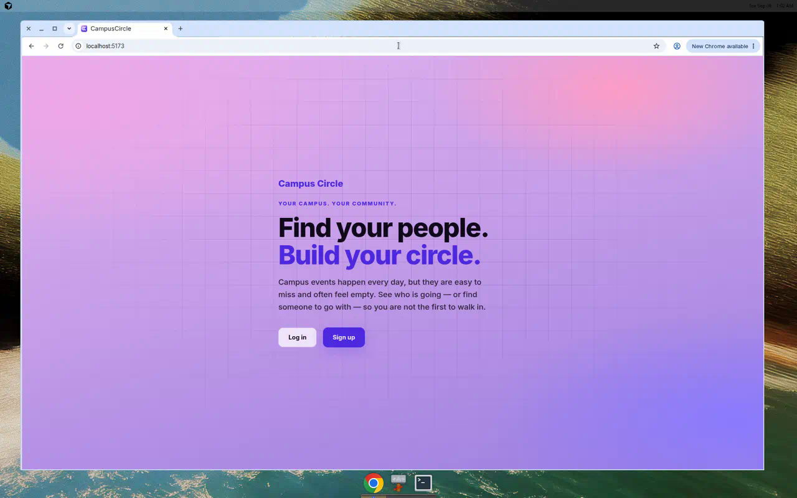

# CampusCircle

CampusCircle helps students find campus events and see who else is going, so showing up feels less awkward.

Campus events already exist, but they are often only posted on university social accounts. Rooms look empty, and a lot of people — especially students without a car, or who are not into nightlife — do not want to be the first to walk in. CampusCircle puts those events in one place. You can mark **Going** or **Looking for someone** so others can reach out and go together.

## Status

| Area | Status |
| --- | --- |
| Welcome, login, and signup screens | Done (real email + password) |
| Events feed, post-event form, RSVP UI | Done (events load/save via API) |
| Profile page | Done (from RSVPs via `GET /profile`) |
| FastAPI hello + health routes | Done |
| PostgreSQL connection via `.env` | Done |
| Create event API (`POST /events`) | Done |
| List events API (`GET /events`) | Done |
| Wire frontend events to API | Done |
| Save RSVP changes | Done |
| Profile from RSVPs | Done |
| Real login / auth | Done (signup, login, logout token) |
| RSVPs follow the logged-in user | Done |
| Events list requires login | Done |

Signup and login check a real account. The password is stored as a salted PBKDF2 hash, not as the text you type. The events list, creating an event, RSVP clicks, and the profile page send `Authorization: Bearer` plus the login token.

## Screenshots

### Welcome


### Login


### Events feed


### Post an event


### Profile


## What’s working today

- Browse campus events from the API (PostgreSQL) after you log in
- RSVP: **Going** and **Looking for someone** (saved for the logged-in person)
- Post-event form saves through the API (survives refresh)
- Profile page lists the logged-in person's Going / Looking RSVPs
- Logout confirmation dialog
- Backend `GET /` and `GET /health` (health also checks the database)
- Backend `POST /signup`, `POST /login`, `POST /logout`, `GET /me`
- Backend `POST /events` / `GET /events` / `GET /events/{id}` / `POST /events/{id}/rsvp` / `GET /profile` (each requires the login token)
- CORS enabled so the React app (port 5174) can call the API (port 8000)

Not yet: photo upload, clubs, chat, maps, or admin tools.

## Tech stack

- **Frontend:** React + TypeScript (Vite)
- **Backend:** FastAPI
- **Database:** PostgreSQL. Startup creates `users`, `sessions`, `events`, and `rsvps`. `sessions` stores the login token.

## Run it

PostgreSQL first, then the API, then the website. The API will not start without the database.

1. Install PostgreSQL, start it, and create the database. On Ubuntu the service command is often blocked, so start cluster 16 directly. Full notes are in [backend/README.md](backend/README.md).

```bash
sudo apt-get update
sudo apt-get install -y postgresql
sudo pg_ctlcluster 16 main start
sudo -u postgres psql -c "CREATE USER campuscircle WITH PASSWORD 'campuscircle';"
sudo -u postgres psql -c "CREATE DATABASE campuscircle OWNER campuscircle;"
```

2. Start the API. `.venv` and `.env` are local. Git does not store them. Copy the example env file once. It points at the database created above.

```bash
cd backend
sudo apt-get install -y python3-venv
python3 -m venv .venv
source .venv/bin/activate
pip install -r requirements.txt
cp .env.example .env
uvicorn app.main:app --reload
```

- http://localhost:8000/health — `"database": "ok"` means PostgreSQL answered
- http://localhost:8000/docs — try the routes. Events, RSVP, and profile need the token from signup or login

3. Start the website in a second terminal.

```bash
cd frontend
npm install
npm run dev
```

Open [http://localhost:5174](http://localhost:5174). Sign up, or log in. The browser keeps the token and sends it on the events list, creating an event, RSVP, and profile.

API tests, from `backend` with the virtualenv active:

```bash
pytest
```

They use a separate database, `campuscircle_test`. Create it once the same way as `campuscircle` if it does not exist yet.

## Repository layout

This repo is a **monorepo**: the React app and the FastAPI app live side by side.

```
campus-circle/
├── docs/screenshots/         # README screenshots
├── frontend/                 # React + TypeScript (Vite)
│   └── src/
│       ├── api/              # backend calls
│       ├── components/       # reusable UI
│       ├── data/             # form options and card colors
│       ├── pages/            # Welcome, Events, Profile
│       └── types/            # TypeScript shapes (Event, …)
└── backend/                  # FastAPI + PostgreSQL
    ├── .env.example
    ├── requirements.txt
    └── app/
        ├── main.py           # FastAPI app
        ├── database.py       # Postgres connection
        ├── routers/          # HTTP URLs (`events.py`)
        ├── models/           # PostgreSQL tables (`event.py`)
        └── schemas/          # JSON in/out (`event.py`)
```

Read [STRUCTURE.md](STRUCTURE.md) for why each folder exists.
