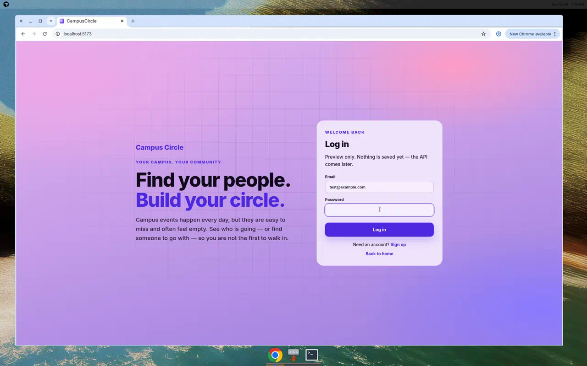
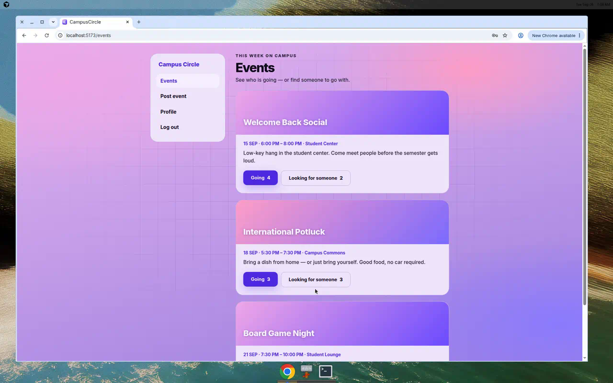
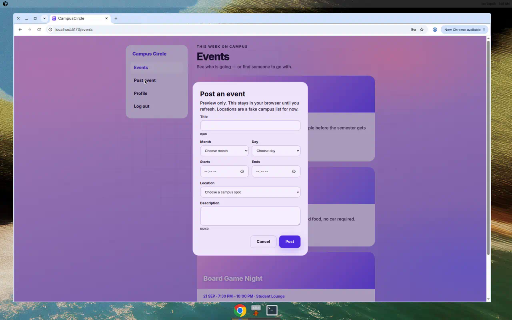
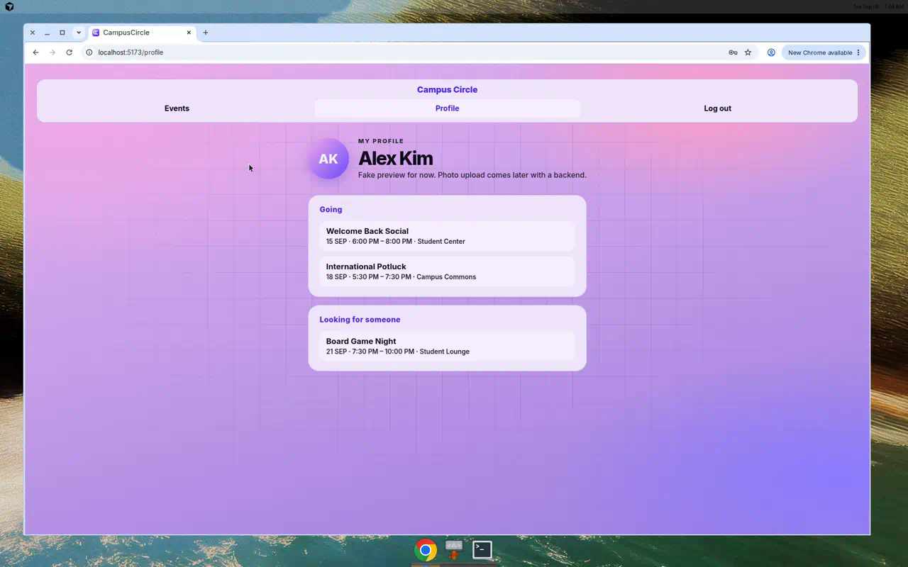

# CampusCircle

CampusCircle is a small web app where students can find campus events, see who is going, and save their own plans.

## Problem

Campus events are easy to miss, and walking into a room alone is enough to make people stay home. CampusCircle puts those events in one place. A student can mark **Going** or **Looking for someone** so it is easier to show up with company.

## Features

- Create an account, log in, and log out.
- Passwords are stored as salted PBKDF2-SHA256 hashes. The password text is not stored.
- A login creates a random session token. The browser sends it as `Authorization: Bearer …` on later requests.
- Logged-in students can browse events and post a new one.
- Events and RSVPs are saved in PostgreSQL and stay there after a refresh.
- One person has one RSVP per event: **Going** or **Looking for someone**. Choosing the same status again removes it. Choosing the other status switches it.
- The profile page lists that person’s Going and Looking events.
- Opening the event list, posting an event, saving an RSVP, or loading a profile without a token returns 401.

## Tech stack

- **Frontend:** React, TypeScript, Vite
- **Backend:** FastAPI
- **Database:** PostgreSQL, accessed with SQLAlchemy
- **Tests:** pytest

## Architecture

The browser talks to the API. The API talks to PostgreSQL. The website runs on port 5174 and the API on port 8000.

```
Browser (React)
    |  Authorization: Bearer <token>
    v
FastAPI
    |
    v
PostgreSQL
    users      account name, email, password hash
    sessions   login token for one signed-in browser
    events     title, time, place, description
    rsvps      one Going or Looking row per person per event
```

Startup creates those tables if they are missing. The token in `sessions` is what a protected request checks. Logging out deletes that token.

## Screenshots

### Welcome


### Login


### Events feed


### Post an event


### Profile


## Run locally

Start PostgreSQL, then the API, then the website. The API will not start until the database exists.

1. Install and start PostgreSQL, then create the app database. On Ubuntu, `sudo service postgresql start` is often blocked, so this uses cluster 16. More detail is in [backend/README.md](backend/README.md).

```bash
sudo apt-get update
sudo apt-get install -y postgresql
sudo pg_ctlcluster 16 main start
sudo -u postgres psql -c "CREATE USER campuscircle WITH PASSWORD 'campuscircle';"
sudo -u postgres psql -c "CREATE DATABASE campuscircle OWNER campuscircle;"
```

2. Start the API. `.venv` and `.env` stay on your machine. Git does not store them.

```bash
cd backend
sudo apt-get install -y python3-venv
python3 -m venv .venv
source .venv/bin/activate
pip install -r requirements.txt
cp .env.example .env
uvicorn app.main:app --reload
```

- http://localhost:8000/health should include `"database": "ok"`.
- http://localhost:8000/docs lists the routes. Events, RSVP, and profile need a token from signup or login.

3. In a second terminal, start the website.

```bash
cd frontend
npm install
npm run dev
```

Open [http://localhost:5174](http://localhost:5174), then sign up or log in.

## Tests

From `backend`, with the virtualenv active:

```bash
sudo -u postgres psql -c "CREATE DATABASE campuscircle_test OWNER campuscircle;"
pytest
```

Create `campuscircle_test` once. The tests use that database, not the one the app uses while you click around.

The folder map is in [STRUCTURE.md](STRUCTURE.md).
